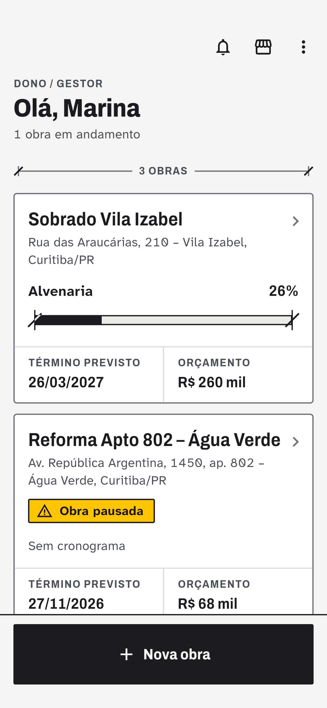
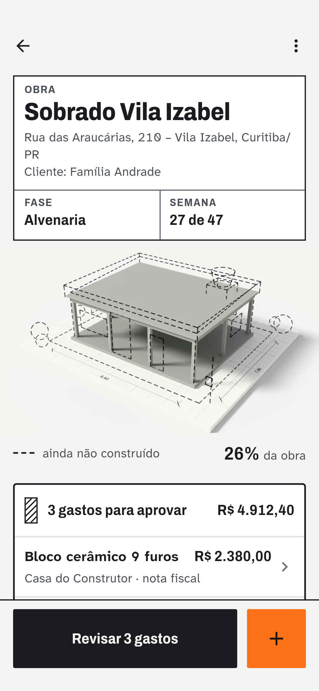
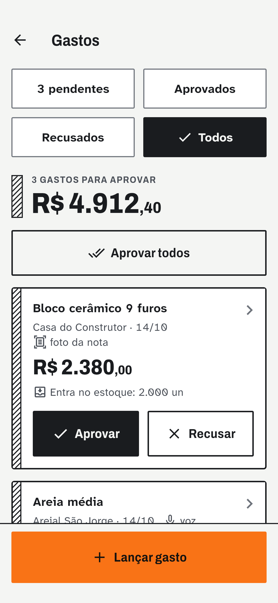
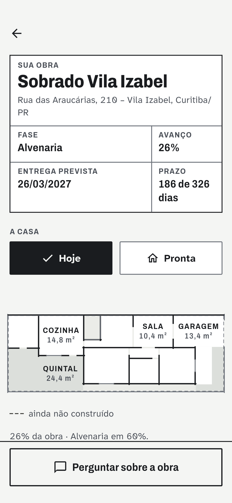
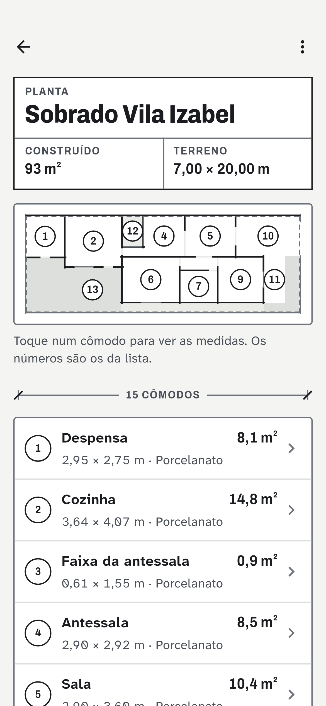
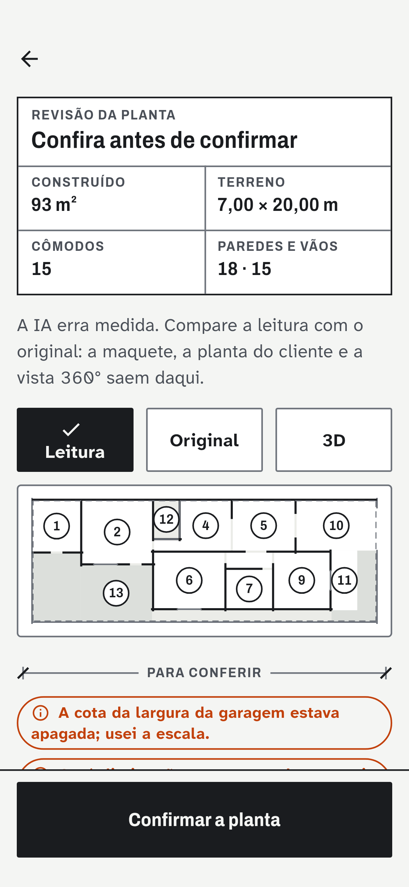
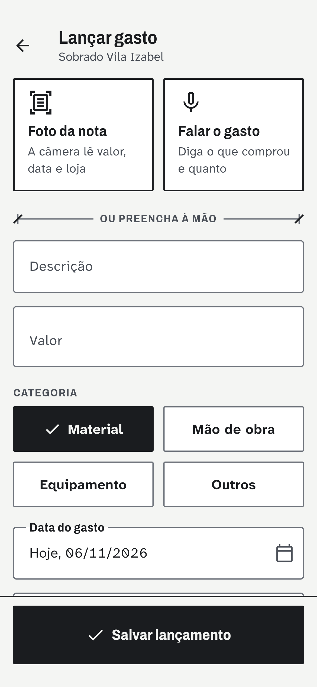
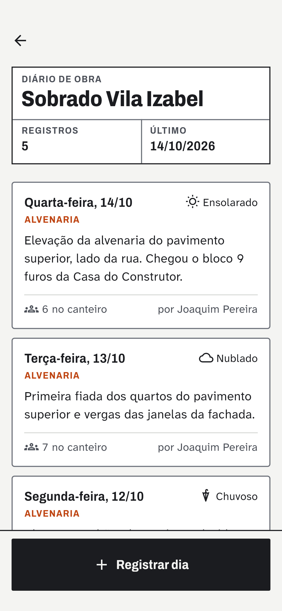

# 🏗️ Obra na Mão

> **Gestão inteligente de obras na palma da mão.**
> Aplicativo Android para controle de custos, equipe e avanço de obras de construção civil, com IA que roda no próprio celular, maquete 3D que cresce junto com a obra e área de acompanhamento para o cliente.

<p>
  
  
  
  
</p>

<p align="center">
  
  
  
  
</p>

---

## 📋 Sobre o projeto

O **Obra na Mão** é um projeto desenvolvido individualmente no curso de **Engenharia de Software** do **Centro Universitário Católica de Santa Catarina (CatólicaSC)**.

Ele nasceu de um problema real e comum nas obras de pequeno e médio porte: a gestão feita "no caderninho", no grupo de WhatsApp e na memória do dono. Esse modelo informal faz o construtor **perder o controle dos custos**, **não enxergar o gasto real por obra** e **não ter registro auditável** do que acontece no canteiro.

O Obra na Mão coloca o controle da obra no celular, de forma simples e pensada para o canteiro: botões grandes, uso com uma mão, leitura fácil no sol e funcionamento sem internet.

🎥 **Vídeo de apresentação (pitch):** [assista aqui](https://youtu.be/Z8BTWrMxLTY)

---

## 🎯 O problema

| Dor | Impacto |
|-----|---------|
| Custos anotados em papel | O estouro do orçamento só é percebido no fim da obra |
| Sem visão do gasto por categoria | Impossível comparar obras ou planejar compras |
| Comunicação solta (WhatsApp, boca a boca) | Nada fica registrado nem auditável |
| Cliente sem informação | Liga toda semana para saber "como está a obra" |

Estima-se que **mais de 30% do custo de uma obra** pode se perder com desperdício e retrabalho mal controlados. Os ERPs de construção existentes são caros e voltados para grandes empresas, e deixam o pequeno construtor sem ferramenta adequada.

---

## 💡 A solução

Um aplicativo **Android** com **três perfis de acesso** e **fluxo de aprovação**:

- **👷 Mestre de obras:** lança gastos (por foto da nota ou por voz), registra o diário do dia e atualiza o estoque. O que ele lança fica pendente até o dono aprovar.
- **🧑‍💼 Dono / gestor:** aprova ou recusa cada gasto numa fila com "desfazer", acompanha custo, prazo e avanço na central da obra e recebe o relatório da semana.
- **🏠 Cliente:** entra com um código de acompanhamento e vê a fase atual, a maquete da casa hoje e pronta, cada cômodo (até em 360°), as etapas e o diário. **Nenhum dado financeiro chega até ele:** as regras do Firestore recusam a leitura dos lançamentos para este perfil, então não é só a tela que esconde.

---

## ✨ Funcionalidades

**Custos e aprovação**
- Lançamento de gastos por categoria (material, mão de obra, equipamento)
- **Nota fiscal por foto:** o OCR preenche fornecedor, CNPJ, data, total e itens
- **Gasto por voz:** a frase falada vira o lançamento preenchido, sem internet
- Fila de aprovação do dono, com "aprovar todos" e desfazer
- Gráficos por categoria e por semana e previsão de estouro do orçamento

**Canteiro**
- Diário de obra por voz ou pela foto do canteiro (clima, equipe, fase)
- Estoque com alerta de mínimo e previsão de quando o material acaba
- Cronograma por fases com % de conclusão
- Galeria em linha do tempo, com comparação entre duas fotos
- Fornecedores cadastrados sozinhos a partir das notas e lançamentos

**Maquete e planta**
- **Maquete 3D** da obra que se constrói conforme o cronograma: fundação, estrutura, alvenaria fiada a fiada, cobertura, instalações, reboco, revestimentos, pintura e acabamento. O que falta aparece tracejado.
- **Planta da obra:** o dono envia a planta (foto, PDF, imagem ou DXF), a IA lê paredes, portas, janelas e cômodos e o dono confere numa tela de revisão antes de confirmar
- A maquete passa a ser **gerada no próprio aparelho a partir da planta**, igual à casa de verdade
- Planta tocável com a ficha de cada cômodo (medidas, área, piso, pé-direito, portas e janelas) e **vista 360°** por dentro
- Imagens **"como vai ficar"** da fachada e dos cômodos, geradas por IA em cima da maquete

**Para todos**
- Área do cliente com a casa "hoje" e "pronta" e um assistente que responde sobre o andamento
- Relatório semanal e perguntas sobre a obra
- Notificações: lembrete do diário, resumo da manhã, aprovações e alertas
- Cadastro com confirmação de e-mail e CEP conferido nos Correios
- Sincronização em tempo real e **modo offline**
- Tema claro e escuro, seguindo o celular

---

## 🤖 Inteligência artificial

### No aparelho (sem internet, sem custo)

| # | Módulo | Tecnologia | O que faz |
|---|--------|-----------|-----------|
| 1 | Nota fiscal por foto | **Google ML Kit** (texto + QR/código de barras) | Lê a nota offline, remonta as colunas pela posição do texto e confere CNPJ e data pela chave de acesso da NFC-e/NF-e |
| 2 | Gasto por voz | **Reconhecedor do Android (offline) + interpretação pt-BR** | Entende valor ("2 mil", "a 35 cada"), fornecedor, data, materiais e categoria, mesmo com o ruído do canteiro |
| 3 | Diário por voz | Reconhecedor do Android + interpretação pt-BR | Transforma o relato do dia em clima, equipe, fase e data |
| 4 | Foto do canteiro | **Google ML Kit** + análise de cor + modelo próprio opcional | Sugere fase, material aparente e clima; só preenche a fase quando a evidência sustenta |
| 5 | Material pela câmera | Google ML Kit (imagem + texto da embalagem) | Identifica o material pela foto e pelo que está escrito no saco, lata ou caixa |
| 6 | Mudança entre fotos | Comparação de imagens (luz normalizada + bordas) | Mede quanto a cena mudou entre duas fotos do mesmo ponto |
| 7 | Previsões | Regressão em Dart | Antecipa quando o orçamento estoura e quando o material acaba |
| 8 | Relatório e assistente | Regras em Dart | Resume a semana e responde perguntas sobre a obra |

Quanto cada uma acerta, medido em 133 casos antes e depois da revisão: [docs/ia/RELATORIO-IA.md](docs/ia/RELATORIO-IA.md).

### Na nuvem (opcional, só para a planta)

| Função | Modelo | O que faz |
|---|---|---|
| `lerPlanta` | Gemini 3.1 Pro | Lê a planta baixa e devolve paredes, vãos e cômodos em metros |
| `gerarImagem` | Nano Banana Pro (4K) | Pinta uma foto realista da casa pronta por cima da maquete, com as mesmas medidas |

As duas rodam em **Cloud Functions do Firebase**. A chave do Gemini fica no Secret Manager do Google Cloud e **nunca entra no app**. Só o dono da obra pode chamar, com limite por mês. Custo estimado: cerca de **US$ 2 por obra**, uma vez só. Sem as funções publicadas, o resto do app funciona normalmente. Passo a passo, custos e prompts: [docs/ia/gemini-planta.md](docs/ia/gemini-planta.md).

---

## 🎨 Design "Prancheta"

A interface fala a língua do desenho técnico: papel, grafite, cota, carimbo e traço, com o laranja da marca como destaque. As regras são de canteiro: contraste alto para o sol, alvos de toque de 48 a 72 dp, a ação principal sempre no rodapé, status nunca só por cor e "desfazer" no lugar de diálogos de confirmação. As fontes vão embutidas no app (Archivo, Atkinson Hyperlegible e IBM Plex Mono).

Referência completa: [docs/redesign/design-system.md](docs/redesign/design-system.md). Capturas de todas as telas, claro e escuro: [docs/redesign/depois/](docs/redesign/depois/).

<p align="center">
  
  
  
  
</p>

---

## 🛠️ Tecnologias

| Camada | Stack |
|--------|-------|
| App | Flutter 3.47 (Android), Provider, go_router |
| Nuvem | Firebase Auth, Cloud Firestore (com cache offline), Cloud Functions, Storage |
| Funções | Node 22 + TypeScript, `@google/genai`, `dxf-parser` |
| IA no aparelho | Google ML Kit (TensorFlow Lite), reconhecedor de voz do Android |
| 3D | `flutter_scene` (Flutter GPU sobre Impeller), maquete gerada em glb no aparelho; reserva em imagem e planta 2D |
| Gráficos | fl_chart |
| Notificações | flutter_local_notifications + Workmanager |
| CI | GitHub Actions: testes, análise e APK publicado na aba Releases |

---

## 📁 Estrutura do repositório

```
obra_facil/          # o app Flutter
├── lib/
│   ├── design/      # design system Prancheta e a maquete 3D (gerador da planta)
│   ├── models/      # entidades (obra, lançamento, planta…) com toMap/fromMap
│   ├── services/    # Firebase e as IAs (ia/)
│   ├── providers/   # estado da sessão
│   ├── router/      # rotas e transições
│   ├── screens/     # telas por módulo
│   └── widgets/     # componentes compartilhados
├── test/            # testes de unidade, de tela, de avaliação das IAs e capturas
└── firestore.rules  # regras de segurança
functions/           # Cloud Functions da IA da planta (Gemini)
ferramentas/         # scripts: maquete no Blender, ícone, planta de exemplo, treino do modelo
docs/                # relatório das IAs, IA da planta, design system e capturas
```

---

## ▶️ Como rodar

- **Configurar e rodar o app:** [obra_facil/SETUP.md](obra_facil/SETUP.md) (Flutter, Firebase, regras e roteiro de demonstração)
- **Baixar o APK pronto:** aba [Releases](https://github.com/LucasMueller134/Obrafacil/releases), gerado pelo GitHub Actions a cada build
- **Ligar a IA da planta:** [docs/ia/gemini-planta.md](docs/ia/gemini-planta.md)
- **Treinar o modelo próprio de fases:** [docs/ia/treinar-modelo.md](docs/ia/treinar-modelo.md)

```bash
cd obra_facil
flutter pub get
flutter test
flutter run --enable-flutter-gpu
```

---

## 📚 Contexto acadêmico

- **Instituição:** Centro Universitário Católica de Santa Catarina (CatólicaSC)
- **Curso:** Engenharia de Software
- **Entrega:** portfólio individual (vídeo pitch, README e documento de portfólio)

---

## 👤 Autor

**Lucas Mueller**
Engenharia de Software, CatólicaSC

---

<p align="center"><i>Menos caderninho. Mais controle. Inteligência no canteiro.</i></p>
